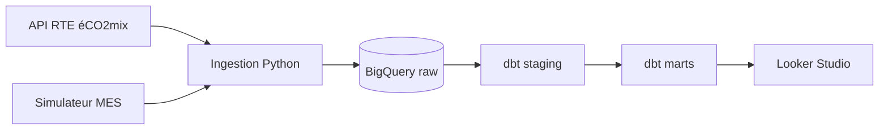

# Factory OEE ELT

Pipeline de données cloud qui calcule le TRS (OEE), les causes d'arrêt et le CO2
d'une ligne de faisceaux électriques automobiles.

## Architecture



## Avancement

| Jour | Contenu | Statut |
|---|---|---|
| 1 | Poste de travail, GitHub, Google Cloud, compte de service | ✅ |
| 2 | Extraction de l'API RTE et chargement dans BigQuery (`raw.rte_eco2mix`) | ✅ |
| 3 | Simulateur MES (`raw.mes_production_15min`), 11 tests pytest | ✅ |
| 4 | Exploration SQL : TRS, Pareto des arrêts, énergie et CO2 | ✅ |
| 5 | dbt : sources, 2 modèles de staging, seed, 11 tests de données | ✅ |
| 6 | dbt marts : TRS et CO2 par jour | ⏳ |
| 7 | Orchestration Airflow (Docker) | ⏳ |
| 8 | CI/CD GitHub Actions | ⏳ |
| 9 | Dashboard Looker Studio | ⏳ |

## Choix techniques

- **ELT** : données brutes gardées telles quelles, transformations en SQL versionné et testé (dbt).
- **Idempotence** : chargement en `WRITE_TRUNCATE`, simulateur déterministe.
- **Fuseaux horaires** : stockage en UTC, jours de production en heure de Paris.
- **Sécurité** : aucun secret dans le dépôt (variables d'environnement, `.gitignore`).

## Lancer le projet

```bash
python3 -m venv .venv && source .venv/bin/activate
pip install -r requirements.txt
export GCP_PROJECT_ID=<id> GOOGLE_APPLICATION_CREDENTIALS=<chemin/de/la/cle.json>
python -m ingestion.main --days 30
cd dbt && dbt build
```