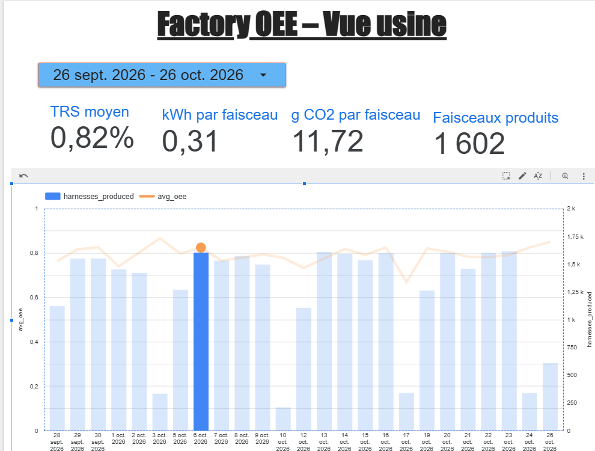
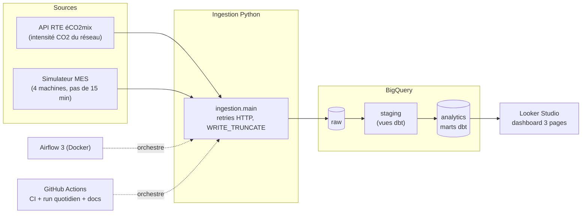
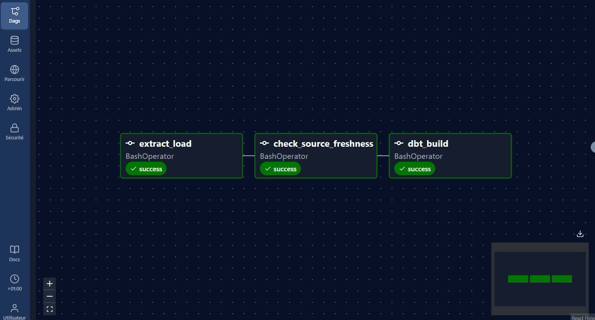

# 🏭 Factory OEE ELT

[](https://github.com/ELYES-ben/factory-oee-elt/actions/workflows/ci.yml)
[](https://github.com/ELYES-ben/factory-oee-elt/actions/workflows/daily.yml)
[](https://elyes-ben.github.io/factory-oee-elt/)


**Pipeline ELT cloud, de bout en bout, qui mesure chaque jour le TRS (OEE), les causes d'arrêt
et l'empreinte CO2 d'une ligne de production de faisceaux électriques automobiles.**

Les données de production (MES) sont croisées avec l'intensité carbone réelle du réseau
électrique français (API RTE éCO2mix) pour répondre à trois questions :
**Comment va l'usine ? Quelle machine freine la ligne, et pourquoi ? Combien coûte chaque faisceau en énergie et en CO2 ?**

📊 **[Ouvrir le dashboard](https://datastudio.google.com/reporting/de9b106a-066b-49d5-b19e-e26123262a64)** ·
📚 **[Documentation dbt et lineage](https://elyes-ben.github.io/factory-oee-elt/)** ·
⚙️ **[Exécutions du pipeline](https://github.com/ELYES-ben/factory-oee-elt/actions)**



---

## Sommaire

- [Contexte métier](#contexte-métier)
- [Architecture](#architecture)
- [Stack technique](#stack-technique)
- [Modèle de données](#modèle-de-données)
- [Indicateurs](#indicateurs)
- [Qualité et fiabilité](#qualité-et-fiabilité)
- [Orchestration](#orchestration)
- [Dashboard](#dashboard)
- [Choix techniques](#choix-techniques)
- [Structure du dépôt](#structure-du-dépôt)
- [Lancer le projet](#lancer-le-projet)
- [Limites et pistes d'amélioration](#limites-et-pistes-damélioration)

---

## Contexte métier

Une ligne d'assemblage de faisceaux électriques compte **4 machines** :

| Étape | Machine | Rôle |
|---|---|---|
| 1 | `CUT-01`, `CUT-02` | Coupe et sertissage des fils |
| 2 | `WELD-01` | Soudure ultrason des épissures |
| 3 | `TEST-01` | Test électrique final (sortie de ligne : 1 pièce bonne = 1 faisceau livré) |

L'usine tourne du lundi 5 h au samedi 5 h, en 3 équipes (matin, après-midi, nuit).
Le MES enregistre, pour chaque machine et chaque quart d'heure, le temps de marche,
les arrêts et leur motif, et les pièces produites et rebutées.

**Le problème :** ces données existent, mais personne ne sait chaque matin quel est le TRS
de la veille, quelle machine le dégrade, ni l'impact carbone de la production, qui dépend
du mix électrique du moment (nucléaire, gaz, renouvelables).

---

## Architecture



Le flux suit le principe **ELT** : les données brutes sont chargées telles quelles dans `raw`,
puis toutes les transformations sont faites **dans BigQuery**, en SQL versionné et testé avec dbt.

---

## Stack technique

| Couche | Outil | Rôle dans le projet |
|---|---|---|
| Extraction et chargement | Python 3.12, `requests`, `google-cloud-bigquery` | Appel de l'API RTE, simulation du MES, chargement dans `raw` |
| Entrepôt | Google BigQuery (EU) | Stockage et calcul |
| Transformation | dbt Core 1.12 + dbt-bigquery | Staging, marts, tests, documentation |
| Orchestration | Apache Airflow 3 (Docker Compose) | DAG quotidien avec dépendances et relances |
| CI/CD | GitHub Actions | Lint et tests à chaque push, run quotidien dans le cloud, publication de la doc |
| Qualité du code | ruff, pytest | Style, erreurs, tests unitaires Python |
| Visualisation | Looker Studio | Dashboard partagé, mis à jour automatiquement |

---

## Modèle de données

```text
raw (chargé par Python)          staging (vues)              marts / analytics (tables)
─────────────────────────        ──────────────────          ──────────────────────────────
rte_eco2mix              ──────▶ stg_rte__grid_co2   ──┐
mes_production_15min     ──────▶ stg_mes__production ──┼──▶ fct_production_15min ──▶ fct_oee_daily ──▶ fct_plant_daily
seeds : machines.csv     ─────────────────────────────┼──▶ dim_machines
        downtime_reasons.csv ─────────────────────────┴──▶ dim_downtime_reasons
```

| Modèle | Grain (une ligne =) | Contenu principal |
|---|---|---|
| `fct_production_15min` | une machine × un quart d'heure | marche, arrêts et motif, pièces, énergie (kWh), CO2 (kg), équipe |
| `fct_oee_daily` | une machine × un jour | disponibilité, performance, qualité, TRS |
| `fct_plant_daily` | un jour | faisceaux produits, TRS moyen, kWh et g CO2 par faisceau |
| `dim_machines` | une machine | étape, cadence idéale, puissance |
| `dim_downtime_reasons` | un motif d'arrêt | libellé, équipe responsable, arrêt planifié ou non |

Le lineage complet est visible dans la **[documentation dbt](https://elyes-ben.github.io/factory-oee-elt/)**.

---

## Indicateurs

| Indicateur | Formule |
|---|---|
| Disponibilité | temps de marche ÷ temps d'ouverture |
| Performance | (pièces produites × temps de cycle idéal) ÷ temps de marche |
| Qualité | pièces bonnes ÷ pièces produites |
| **TRS (OEE)** | disponibilité × performance × qualité = temps utile ÷ temps d'ouverture |
| Énergie | puissance en marche × temps de marche + puissance à vide × temps d'arrêt |
| CO2 | énergie (kWh) × intensité carbone du réseau à l'heure près (g CO2/kWh, RTE) |

> **Règle appliquée partout :** sur une période, un ratio se calcule en **somme ÷ somme**,
> jamais en moyenne de ratios journaliers (un jour de panne ne doit pas peser autant qu'un jour normal).

---

## Qualité et fiabilité

| Mécanisme | Détail |
|---|---|
| **Tests dbt** | 30 tests de données (unicité, non-nullité, valeurs acceptées, relations), dont 3 tests métier en SQL : `TRS = D × P × Q`, `0 ≤ TRS ≤ 1`, temps de marche entre 0 et 15 min |
| **Test unitaire dbt** | Calcul du TRS vérifié sur un jeu de données fixé à la main |
| **Fraîcheur des sources** | Alerte si les données brutes ont plus de 26 h, blocage du pipeline au-delà de 50 h |
| **Tests Python** | 11 tests pytest (simulateur MES, client de l'API RTE) |
| **CI** | À chaque push : ruff, pytest, puis `dbt build` complet dans un dataset isolé `dbt_ci` |
| **Idempotence** | Chargement en `WRITE_TRUNCATE`, simulateur déterministe : relancer donne le même résultat, sans doublon |
| **Résilience** | Retries HTTP sur l'API (429, 5xx), 2 relances par tâche dans Airflow, arrêt en cascade si une étape échoue |
| **Sécurité** | Aucun secret dans le dépôt : clé en secret GitHub ou montée en lecture seule dans Docker |

---

## Orchestration

Le pipeline tourne de deux façons, avec **les mêmes trois étapes** :

```text
extract_load  ──▶  check_source_freshness  ──▶  dbt_build --target prod
```

| | Airflow 3 (local, Docker) | GitHub Actions (cloud) |
|---|---|---|
| Planification | Tous les jours à 5 h UTC | Tous les jours à 5 h 17 UTC |
| Relances | 2, espacées de 5 min | Re-run manuel |
| Interface | Grid, Graph, logs, Clear | Onglet Actions, logs |
| Intérêt | Orchestrateur standard en entreprise | Tourne même machine éteinte, gratuit |



Image Airflow personnalisée : dbt et le client BigQuery sont installés dans un environnement
Python séparé (`/opt/pipeline_venv`) pour éviter les conflits de dépendances avec Airflow.
Le code est monté en volume et la clé en lecture seule : rien de secret n'entre dans l'image.

| Workflow | Déclencheur | Rôle |
|---|---|---|
| [`ci.yml`](.github/workflows/ci.yml) | Chaque push et pull request | ruff + pytest, puis `dbt build` sur `dbt_ci` |
| [`daily.yml`](.github/workflows/daily.yml) | 5 h 17 UTC ou manuel | Ingestion, fraîcheur, `dbt build` en production |
| [`docs.yml`](.github/workflows/docs.yml) | Chaque push sur `main` | Publication de la doc dbt sur GitHub Pages |

---

## Dashboard

**[Ouvrir le dashboard Looker Studio](https://datastudio.google.com/reporting/de9b106a-066b-49d5-b19e-e26123262a64)**, conçu en trois niveaux de lecture :

| Page | Question | Contenu |
|---|---|---|
| **Vue usine** | Comment va l'usine ? | Faisceaux produits, TRS, kWh et g CO2 par faisceau, tendance quotidienne |
| **TRS par machine** | Quelle machine freine la ligne, et pourquoi ? | TRS décomposé en disponibilité, performance et qualité |
| **Arrêts & énergie** | Qui doit agir ? | Minutes d'arrêt par motif et équipe responsable, énergie et CO2 par équipe |

---

## Choix techniques

- **ELT plutôt qu'ETL** : les données brutes sont conservées (rejouables), et la logique métier est en SQL lisible, versionné et testé.
- **Staging en vues, marts en tables** : le staging ne coûte rien à stocker, les marts sont rapides à lire pour le dashboard.
- **Fuseaux horaires** : stockage en UTC, jour de production calculé en heure de Paris (changements d'heure gérés).
- **Seeds pour les référentiels** : machines et motifs d'arrêt versionnés dans Git, avec tests.
- **Trois environnements dbt** : `dbt_dev` (développement), `dbt_ci` (tests automatiques), `analytics` (production).

---

## Structure du dépôt

```text
factory-oee-elt/
├── ingestion/            # Extraction (API RTE, simulateur MES) et chargement BigQuery
├── dbt/
│   ├── models/staging/   # Nettoyage et typage des sources
│   ├── models/marts/     # Faits et dimensions (TRS, énergie, CO2)
│   ├── seeds/            # Référentiels : machines, motifs d'arrêt
│   └── tests/            # Tests métier SQL
├── airflow/              # Dockerfile, docker-compose, DAG
├── .github/workflows/    # CI, pipeline quotidien, documentation
├── tests/                # Tests pytest
├── sql/                  # Requêtes d'exploration
└── docs/img/             # Captures du README
```

---

## Lancer le projet

**Prérequis :** Python 3.12, un projet Google Cloud avec BigQuery et un compte de service
(droits d'écriture BigQuery et d'exécution de requêtes), Docker pour la partie Airflow.

```bash
git clone https://github.com/ELYES-ben/factory-oee-elt.git
cd factory-oee-elt
python3 -m venv .venv && source .venv/bin/activate
pip install -r requirements.txt

export GCP_PROJECT_ID=<votre-projet>
export GOOGLE_APPLICATION_CREDENTIALS=<chemin/vers/la/cle.json>

python -m ingestion.main --days 30      # charge raw.rte_eco2mix et raw.mes_production_15min
cd dbt && dbt build                     # construit et teste les modèles dans dbt_dev
```

**Airflow en local :**

```bash
cd airflow
cp .env.example .env                    # puis renseigner ses valeurs
docker compose build
docker compose up airflow-init
docker compose up -d                    # interface : http://localhost:8080 (airflow / airflow)
```

---

## Limites et pistes d'amélioration

- **Données MES simulées** : le simulateur est déterministe et réaliste, mais une vraie intégration passerait par l'export ou l'API du MES de l'usine.
- **Chargement complet sur 30 jours** : simple et idempotent à ce volume ; à plus grande échelle, modèles dbt incrémentaux et tables partitionnées par date.
- **Alerting** : ajouter une notification (e-mail ou Slack) en cas d'échec du pipeline ou de TRS sous l'objectif.
- **Infrastructure as code** : créer les datasets, le compte de service et les droits avec Terraform.
- **Orchestration managée** : Cloud Composer ou un Airflow hébergé pour un fonctionnement 24 h/24 sans machine locale.

---

**Auteur :** Ilyasse Ben Othman, élève ingénieur (double diplôme Génie industriel, Mines Rabat · Data, IMT Mines Albi)
· [LinkedIn](https://www.linkedin.com/in/ilyasse-ben-othman-62a809265)
